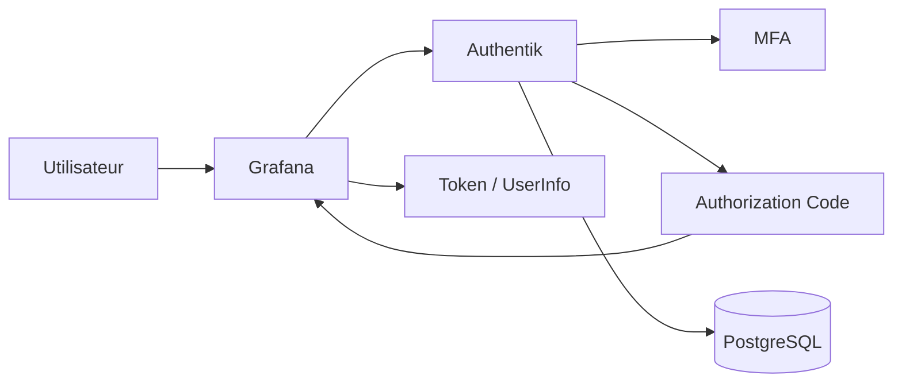

# Nova Services — IAM Laboratory

## Objectif

Installer puis faire évoluer un laboratoire IAM Nova Services avec Docker Compose, secrets locaux, persistance et contrôles de santé. Gitea n'est pas retenu.

## TP1 — Infrastructure IAM

- Docker Compose
- PostgreSQL
- Authentik Server et Worker
- Grafana
- persistance
- healthchecks

## TP2 — Identity & Access Management

- identités et attributs métier
- RBAC
- MFA TOTP et récupération
- SSO OIDC vers Grafana
- mapping des rôles et deprovisioning
- provisioning utilisateurs
- cycle de vie
- équipes Grafana
- permissions de dossiers

## Architecture

Les quatre services partagent le réseau Docker `iam-network`. Authentik utilise PostgreSQL en réseau interne.



## Services

| Service | Rôle | Port |
|---|---|---|
| PostgreSQL | Base Authentik | interne uniquement |
| Authentik Server | IAM | 9000 |
| Authentik Worker | tâches asynchrones | aucun |
| Grafana | tableaux de bord | 3000 |

## Prérequis

Docker Engine, Docker Compose v2 et Python 3.9 ou supérieur.

## Installation

```bash
python3 scripts/init_env.py
```

Le script refuse de remplacer un `.env` existant. Ne jamais versionner `.env`.

## Démarrage

```bash
docker compose pull
docker compose run --rm --no-deps --user 0 --entrypoint sh authentik-server -c 'mkdir -p /data/media && chown -R 1000:1000 /data'
docker compose up -d --wait --wait-timeout 600
```

## Initialisation Authentik

Ouvrir `http://localhost:9000/if/flow/initial-setup/` avec le `/` final. Créer manuellement le compte `akadmin` avec un mot de passe fort, puis vérifier Users, Groups, Applications, Flows and Stages.

## Initialisation Grafana

Ouvrir `http://localhost:3000`, avec `admin` et la valeur locale de `GRAFANA_ADMIN_PASSWORD`. Modifier cette variable après initialisation ne réinitialise pas nécessairement le mot de passe déjà stocké.

## Vérifications

```bash
docker compose config --quiet
docker compose ps
bash scripts/verify.sh
```

## Test de persistance

Créer `tp1-persistence` dans Authentik, exécuter `docker compose down`, puis `docker compose up -d --wait --wait-timeout 600`. Vérifier que `akadmin`, le groupe et Grafana existent toujours, puis supprimer uniquement le groupe.

## Arrêt

```bash
docker compose stop
```

## Reprise

```bash
docker compose up -d --wait --wait-timeout 600
```

## Suppression des conteneurs

```bash
docker compose down
```

Ne pas utiliser `docker compose down -v` sauf si l'on souhaite réellement supprimer les données persistantes.

## Préparation du TP2

Le TP2 ajoute la relation `Authentik` → `OAuth2 / OIDC` → `Grafana`. Suivre les procédures dans `docs/comptes.md`, `docs/rbac.md`, `docs/oidc.md` et `docs/tests.md`. Le SSO n'est activé dans Compose qu'après création manuelle du provider et validation de la découverte OIDC.

## Automatisation navigateur TP2

Playwright utilise uniquement Chromium, une viewport `1440x900` et un contexte isolé par utilisateur. Les identifiants et le MFA restent saisis manuellement dans la fenêtre Chromium ; aucun secret, QR code ou cookie n'est capturé.

```bash
npm run test:e2e -- --headed
```

La suite capture les preuves qui peuvent être validées automatiquement et indique `SKIPPED` ou `BLOCKED` pour les contrôles nécessitant une action humaine. Les mutations de groupes sont désactivées par défaut :

```bash
TP2_RUN_MUTATIONS=1 npm run test:e2e -- --headed
```

Le déprovisionnement de Bob est une action séparée et destructive ; il ne s'exécute qu'avec `TP2_RUN_DEPROVISION=1` en plus de `TP2_RUN_MUTATIONS=1`. Les captures sont écrites dans `captures/tp2/`, les états temporaires dans `.tmp/playwright/`, puis supprimés en fin de test.

