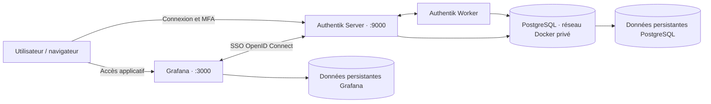

# Nova Services — Laboratoire IAM

**Gestion des identités et des habilitations · TP1 & TP2**

Déploiement d'une infrastructure IAM locale avec **Authentik**, **PostgreSQL** et **Grafana**, puis mise en œuvre de l'authentification fédérée **OpenID Connect**, du MFA et du contrôle d'accès par rôles (RBAC).

Ce dépôt réunit les configurations, les procédures, les scripts de vérification et les comptes rendus d'un laboratoire pédagogique. **Il ne constitue pas une configuration de production.**

## Périmètre du projet

| TP | Objectif | Livrables |
| --- | --- | --- |
| **TP1 — Infrastructure** | Déployer Authentik, PostgreSQL et Grafana avec Docker Compose ; vérifier la santé des services et la persistance des données. | [Compte rendu](docs/COMPTE_RENDU.md) · [Tests](docs/TESTS.md) · [Persistance](docs/PERSISTENCE.md) |
| **TP2 — Identités et habilitations** | Configurer les identités, groupes, MFA TOTP, SSO OIDC, rôles Grafana, permissions de dossiers et cycle de vie des comptes. | [Compte rendu](docs/compte-rendu-tp2.md) · [Matrice des tests](docs/tests.md) · [RBAC](docs/rbac.md) |

**Périmètre retenu :** Gitea, proposé dans le sujet initial du TP1, n'a pas été déployé.

## Architecture



| Technologie | Version du laboratoire | Fonction |
| --- | --- | --- |
| Docker Compose | v2 | Orchestration des services |
| PostgreSQL | 16-alpine | Stockage interne d'Authentik |
| Authentik Server / Worker | 2026.8.6 | Identités, MFA et fournisseur OIDC |
| Grafana | 13.3.1 | Application cliente, rôles et dashboards |
| Playwright / Chromium | Selon le lockfile | Captures et scénarios de vérification |

La communication OIDC distingue l'adresse utilisée par le navigateur (`localhost:9000`) de celle accessible aux conteneurs (`authentik-server:9000`). Voir [la documentation OIDC](docs/oidc.md).

## Fonctionnalités étudiées

- **Provisioning et cycle de vie :** création de comptes, attributs métier, groupes, mobilité et départ.
- **MFA :** dispositifs TOTP et récupération par codes statiques.
- **SSO :** connexion à Grafana par Authentik via OIDC.
- **RBAC :** correspondance des groupes Authentik avec les rôles Grafana.
- **Contrôle d'accès :** droits de consultation, d'édition et permissions des dossiers Dev/RH.
- **Traçabilité :** résultats techniques et fonctionnels documentés, avec distinction entre tests validés, partiels et non exécutés.

### Modèle de rôles

| Groupe Authentik | Rôle Grafana attendu |
| --- | --- |
| Admin | Admin d'organisation |
| Dev | Editor |
| RH | Viewer |
| Audit | Viewer |

Il s'agit du **modèle d'habilitation étudié**, non d'une liste des appartenances actuelles. L'état effectivement mesuré figure dans [la recette finale](docs/RECETTE_FINALE.md).

## Exécution locale

**Prérequis :** Docker avec Compose v2, Python 3.9+ ; Node.js 20+ uniquement pour les scripts Playwright.

```bash
# Depuis la racine du dépôt, sur un laboratoire déjà configuré
docker compose up -d --wait --wait-timeout 600
./scripts/verify.sh
./scripts/verify_oidc.sh
curl -fsS http://localhost:3000/api/health
```

**Première installation :** suivre le [guide d'installation](docs/INSTALLATION.md). Le modèle [.env.example](.env.example) ne contient pas les secrets réels : la configuration du fournisseur OIDC et les identifiants correspondants doivent être préparés séparément.

Pour les vérifications navigateur, voir les scripts dans `scripts/` et la documentation des tests. Ne pas réinitialiser les volumes ni réactiver des comptes désactivés pour rejouer des scénarios historiques sans environnement de test distinct.

## État de validation

| Domaine | Synthèse |
| --- | --- |
| Déploiement Docker et santé des services | **Validé** |
| Configuration OIDC et découverte du fournisseur | **Validé techniquement** |
| Synchronisation des rôles Alice / Bob / Charlie | **Validée pour les rôles observés** |
| Gestion des comptes et départ de Bob | **Partielle** : Authentik désactivé ; désactivation du profil Grafana non aboutie |
| Isolation des dossiers et scénarios d'édition | **À compléter** : preuves incomplètes et anomalie Alice → Dev consignée |
| MFA négatif, récupération et sessions après départ | **Non entièrement testés** |

Les détails, preuves et réserves sont conservés dans la [matrice TP2](docs/tests.md) et la [recette finale](docs/RECETTE_FINALE.md). Le README ne remplace pas les résultats d'exécution.

## Documentation et preuves

| Ressource | Contenu |
| --- | --- |
| [Dossier TP1](captures/tp1/README.md) | Captures d'accès Authentik et Grafana |
| [Dossier TP2](captures/tp2/README.md) | Captures IAM, SSO, rôles et dashboards |
| [Compte rendu TP1](docs/COMPTE_RENDU.md) | Installation, architecture et vérifications |
| [Compte rendu TP2](docs/compte-rendu-tp2.md) | Identités, MFA, OIDC, RBAC et cycle de vie |
| [Matrice des tests TP2](docs/tests.md) | Attendus, observations, statuts et limites |
| [Architecture](docs/ARCHITECTURE.md) | Organisation technique du laboratoire |
| [Gestion des identités](docs/comptes.md) | Comptes et attributs métier |
| [MFA et récupération](docs/recovery.md) | Dispositifs et procédures |
| [Réponses TP1](docs/REPONSES_TP.md) · [Réponses TP2](docs/questions-tp2.md) | Questions pédagogiques |

Les galeries de preuves sont volontairement **séparées de cette page d'accueil** afin de conserver un README lisible.

## Sécurité et limites

- Les secrets applicatifs, mots de passe, tokens, cookies et données de sessions ne doivent pas être versionnés ; le fichier `.env` réel reste local.
- Les captures sont sélectionnées pour éviter l'exposition d'informations sensibles et ne sont pas utilisées comme preuve d'une action qu'elles ne montrent pas.
- Le laboratoire utilise **HTTP** et expose les ports **3000** et **9000** sur l'hôte : ce paramétrage est adapté à l'exercice local, **pas à une mise en production**.
- Certaines validations TP2 nécessitent une intervention humaine ou un environnement de test réinitialisable. Les limites et échecs constatés restent documentés.

---

*Projet pédagogique Nova Services — module Gouvernance des identités et des habilitations.*
