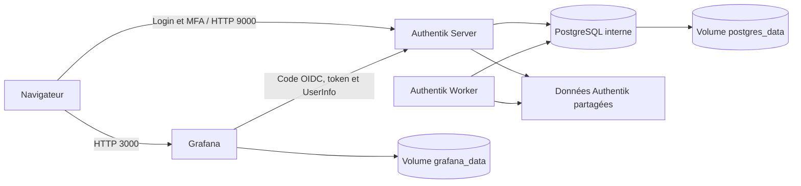
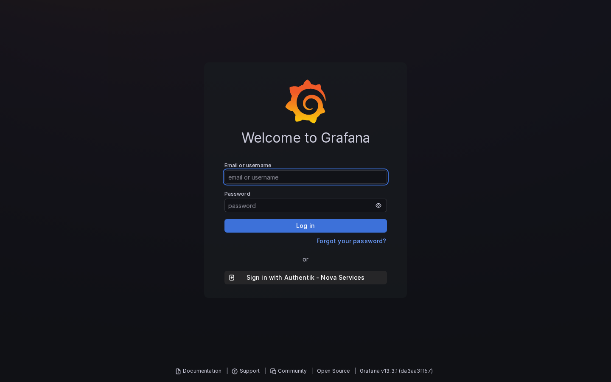
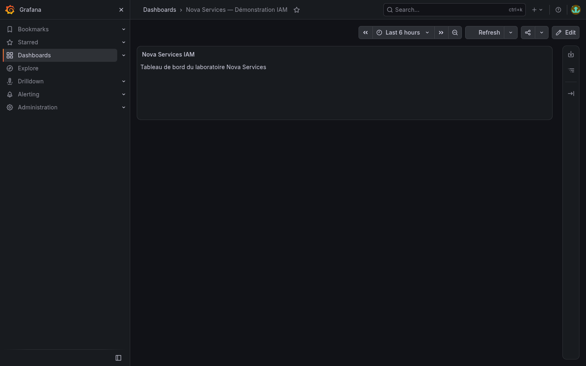
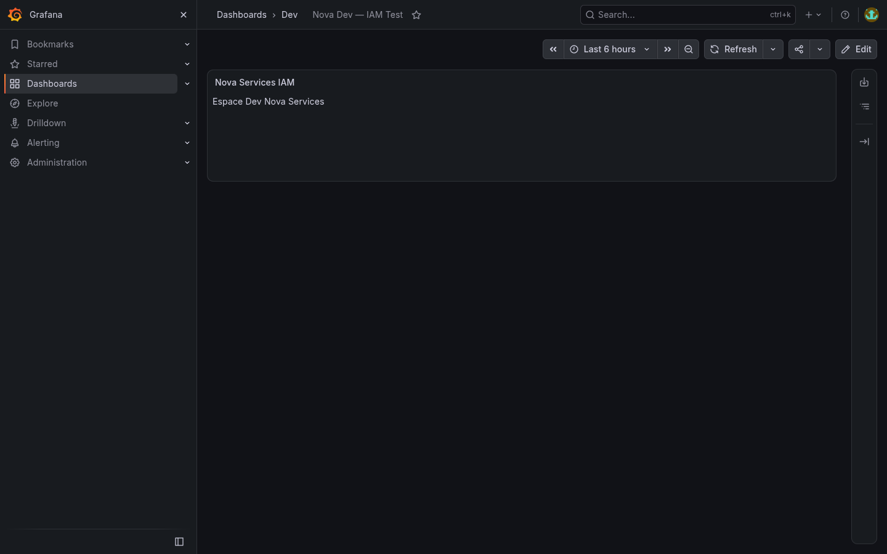
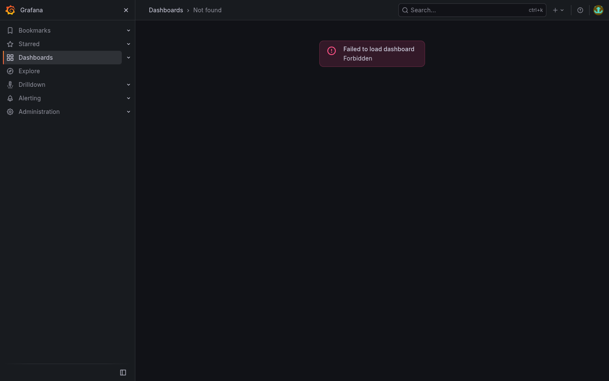

# Nova Services — IAM Lab

Laboratoire scolaire de gestion des identités : construire un socle Docker persistant, fédérer la connexion avec Authentik, puis vérifier les habilitations Grafana. Gitea a volontairement été écarté.

La [recette finale du 25 novembre 2026](docs/RECETTE_FINALE.md) distingue l'état mesuré, les preuves historiques et les tests manquants. Le rendu reste **PARTIAL**.

## TP1 — Infrastructure IAM

PostgreSQL, Authentik Server/Worker et Grafana partagent un réseau Docker. Des healthchecks contrôlent le démarrage et des volumes conservent les données.

[Compte rendu TP1](docs/COMPTE_RENDU.md) · [Réponses TP1](docs/REPONSES_TP.md) · [Persistance](docs/PERSISTENCE.md)

## TP2 — Gouvernance des identités et habilitations

Identités et attributs métier, groupes Admin/Dev/RH/Audit, MFA TOTP, récupération, SSO OIDC, mapping des rôles, équipes et permissions de dossiers. Le départ de Bob a été appliqué dans Authentik.

[Compte rendu TP2](docs/compte-rendu-tp2.md) · [Réponses TP2](docs/questions-tp2.md) · [Matrice des tests](docs/tests.md)

## Technologies

| Composant | Version configurée | Exposition hôte |
|---|---|---|
| PostgreSQL | 16-alpine | aucune |
| Authentik Server | 2026.8.6 | 9000 |
| Authentik Worker | 2026.8.6 | aucune |
| Grafana | 13.3.1 | 3000 |
| Docker Compose | v2 requis | réseau iam-network |
| Playwright | 1.65.1 dans le lockfile | Chromium uniquement |

## Architecture



## Installation

Prévoir Docker Compose v2 et Python 3.9+. Node 20+ est nécessaire seulement pour les captures Playwright.

Le laboratoire existant est déjà initialisé. Pour le reprendre :

```bash
docker compose up -d --wait --wait-timeout 600
./scripts/verify.sh
./scripts/verify_oidc.sh
```

Pour une installation vierge, suivre [INSTALLATION.md](docs/INSTALLATION.md). Le Compose final exige aussi un Client ID et un Client Secret OIDC : le script de génération des secrets TP1 ne suffit pas, à lui seul, à recréer toute la configuration TP2.

## Configuration sécurisée

[.env.example](.env.example) décrit les variables ; les valeurs réelles restent dans un fichier local .env de mode 0600. La modification du mot de passe dans ce fichier ne réinitialise pas un compte Grafana existant.

Grafana utilise localhost:9000 dans le navigateur et authentik-server:9000 pour le back channel. Le [document OIDC](docs/oidc.md) détaille le flux et la claim nova_groups.

## Tests automatisés

```bash
docker compose config --quiet
./scripts/verify.sh
./scripts/verify_oidc.sh
curl -fsS http://localhost:3000/api/health
npm ci
npx playwright install chromium
node scripts/capture_release.mjs
```

Le script de captures consulte les écrans courants et la liste des utilisateurs Grafana avec le compte local existant. Il ne modifie pas les habilitations. Les sessions restent en mémoire et le navigateur est fermé à la fin.

La suite historique tests/e2e/tp2-rbac.spec.ts est conservée comme scénario pédagogique. Elle suppose Bob actif et doit être considérée comme partielle : ses anciennes détections de rendu ne prouvent pas toutes les autorisations. Ne pas la relancer intégralement dans l'état final, ni activer ses options de mutation.

## Tests fonctionnels

La [matrice TP2](docs/tests.md) contient les résultats observés. Une connexion MFA exige une intervention humaine. Les tests négatifs TOTP, récupération, sauvegarde Editor et sessions après départ restent incomplets.

## Captures et preuves

[Inventaire TP1](captures/tp1/README.md) · [Inventaire TP2](captures/tp2/README.md)

Écran de connexion Grafana actuel :



Dashboard historique, sans preuve de sauvegarde :



Dashboard Dev historique ; l'image seule n'identifie pas le compte :



Refus RH historique :



## Documentation

- [Architecture](docs/ARCHITECTURE.md), [installation](docs/INSTALLATION.md), [tests TP1](docs/TESTS.md).
- [Comptes](docs/comptes.md), [RBAC](docs/rbac.md), [MFA et récupération](docs/recovery.md).
- [OIDC](docs/oidc.md), [recette finale](docs/RECETTE_FINALE.md).

## Sécurité

Aucun volume n'a été supprimé et Bob n'a pas été réactivé pour le rendu. Les secrets, bases de données, cookies, traces et états Playwright sont exclus de Git. Les captures ont été inspectées ; les valeurs locales et les motifs de secrets ont aussi été recherchés dans l'historique.

Les ports 9000 et 3000 sont publiés sur toutes les interfaces de l'hôte et le laboratoire utilise HTTP. Ce rendu décrit un environnement pédagogique, pas un déploiement de production.

## Résultats

| Contrôle | Statut |
|---|---|
| Compose, quatre services, santé PostgreSQL/Authentik/Grafana | PASS |
| Découverte OIDC et configuration PKCE | PASS |
| Rôles Grafana Alice Viewer, Bob Editor, Charlie Admin | PASS API |
| Bob inactif Authentik, sans groupe, absent de nova-dev | PASS état courant |
| Désactivation du profil Grafana Bob et tests après départ | PARTIAL |
| MFA obligatoire et isolation effective Dev/RH | PARTIAL |

## Limites

Alice est active sans groupe Authentik et sans périphérique MFA enregistré ; son profil Grafana reste Viewer dans nova-rh. La capture 15-folder-rh.png montre un refus, contrairement à son ancienne légende. La cause d'accès Dev n'est pas démontrée ; les ACL courantes sont limitées aux équipes et à Charlie. Les preuves historiques manquantes ne sont pas reconstituées.

## Conclusion

Le socle IAM et la configuration OIDC sont vérifiés. Les documents et preuves rendent visibles les limites restantes. Aucun remote n'est configuré ; le dépôt cible proposé est ronflex00/tp1-tp2-nova-services-iam. La publication attend une décision sur les tests incomplets.
