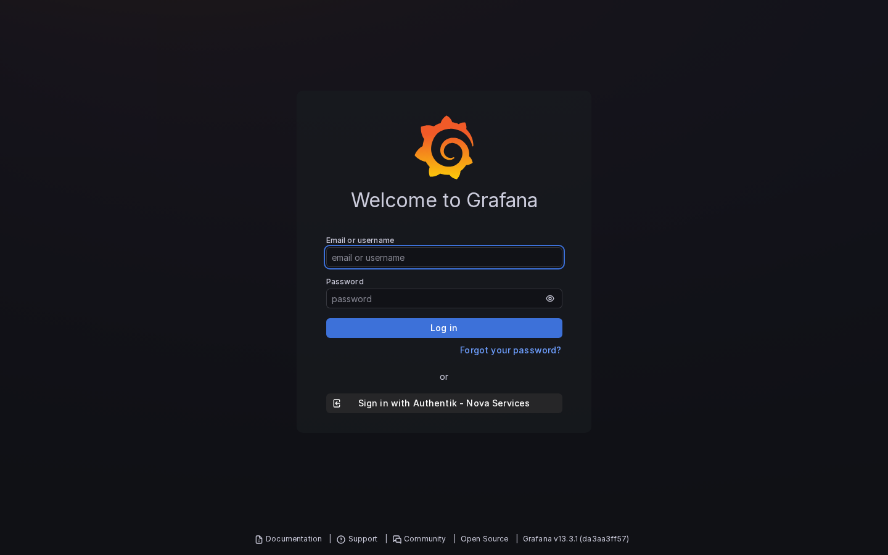

# TP1 — Installation de l'infrastructure IAM

## 1. Contexte et objectifs

Nova Services met en place un laboratoire IAM persistant pour préparer la fédération des identités au TP2. Le périmètre comprend PostgreSQL, Authentik Server, Authentik Worker et Grafana. Gitea a été écarté.

## 2. Architecture et services

Le [diagramme d'architecture](ARCHITECTURE.md) décrit le réseau Docker iam-network. PostgreSQL conserve la base Authentik ; le serveur fournit l'interface web ; le worker exécute les tâches asynchrones ; Grafana constitue l'application cliente.

Les ports hôte sont 9000 pour Authentik et 3000 pour Grafana. PostgreSQL et le worker n'ont pas de port publié. Les deux ports web sont actuellement liés à toutes les interfaces.

## 3. Installation et secrets

La [procédure d'installation](INSTALLATION.md) distingue la reprise du laboratoire existant d'une installation vierge. Le script init_env.py crée les secrets TP1 une seule fois, en mode 0600, et refuse d'écraser un fichier existant. Le Compose final exige les variables OIDC supplémentaires du TP2.

## 4. Vérification des conteneurs

Le 25 novembre 2026 : configuration Compose valide, quatre services healthy, vérification PostgreSQL, liveness/readiness Authentik, worker et santé Grafana réussies. Voir la [recette finale](RECETTE_FINALE.md).

## 5. Accès Authentik et Grafana

Authentik répond sur http://localhost:9000 et Grafana sur http://localhost:3000. L'initialisation des comptes administrateurs a déjà eu lieu ; elle n'a pas été rejouée pour le rendu.

Cette image prouve le chargement de l'interface de connexion, pas la réussite d'une authentification.

## 6. Persistance

Les volumes postgres_data et grafana_data et le montage data/authentik sont présents. La [procédure de persistance](PERSISTENCE.md) reste documentée. Aucun redémarrage ni cycle de suppression/recréation n'a été exécuté dans cette recette ; aucune comparaison visuelle avant/après n'est disponible.

## 7. Captures et questions

L'[inventaire des captures TP1](../captures/tp1/README.md) distingue les fichiers présents et manquants. Les [réponses TP1](REPONSES_TP.md) couvrent les identités, les ports, les secrets, la persistance et les sauvegardes.

## 8. Sécurité et conclusion

PostgreSQL reste interne, le socket Docker n'est pas monté, aucun service n'est privilégié et les secrets ne sont pas versionnés. Le socle TP1 est opérationnel ; le test de persistance avec preuve avant/après reste PARTIAL.
