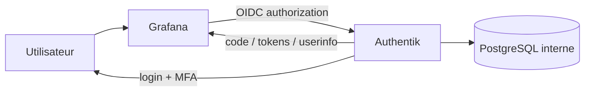
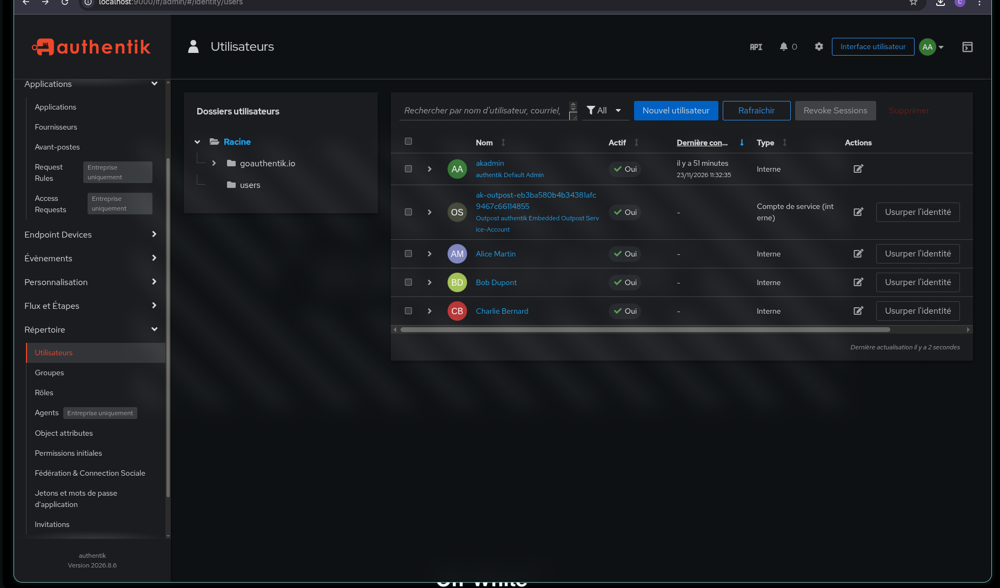
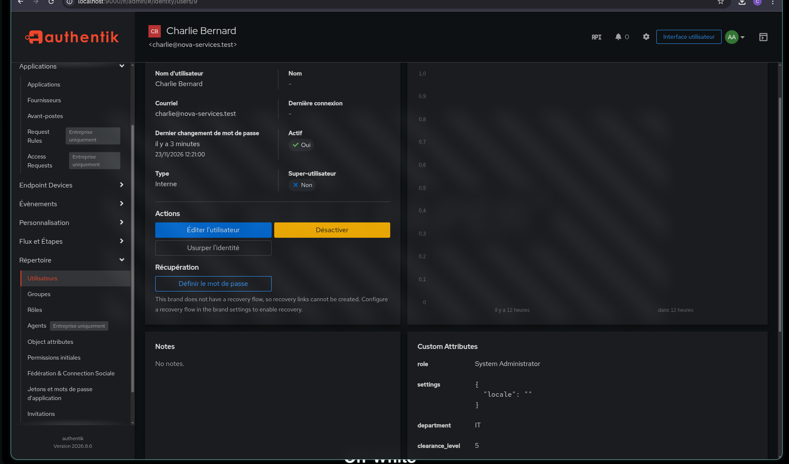
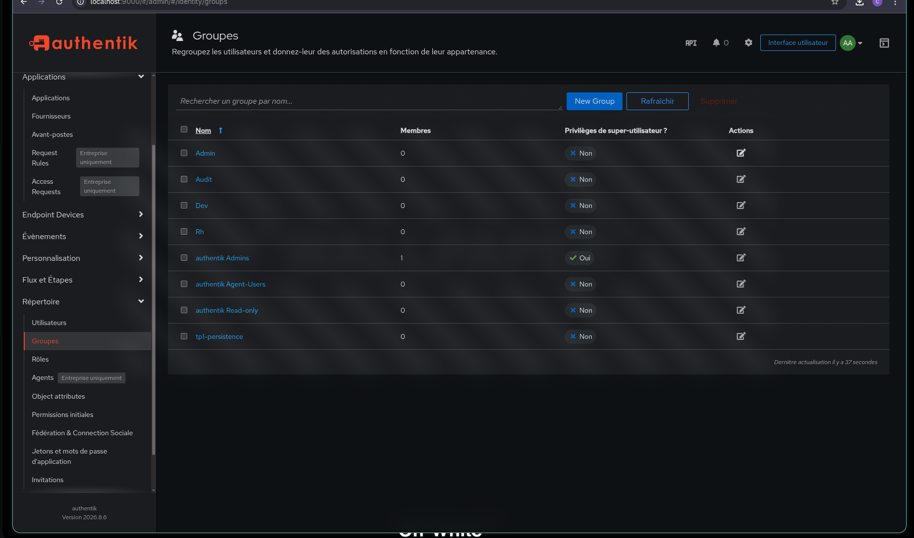
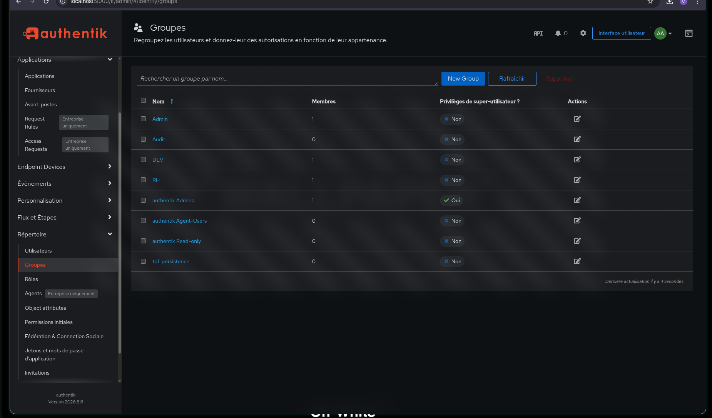
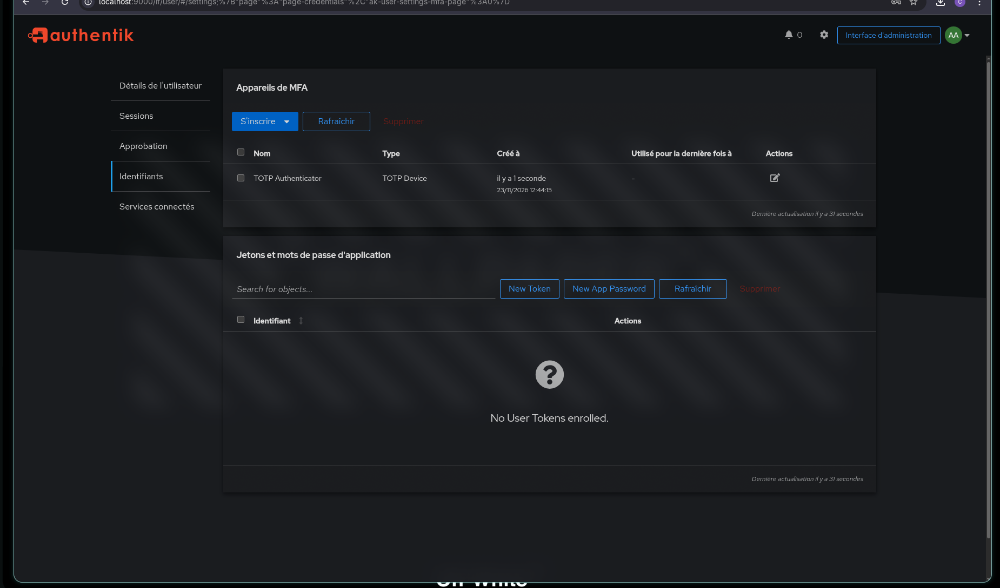
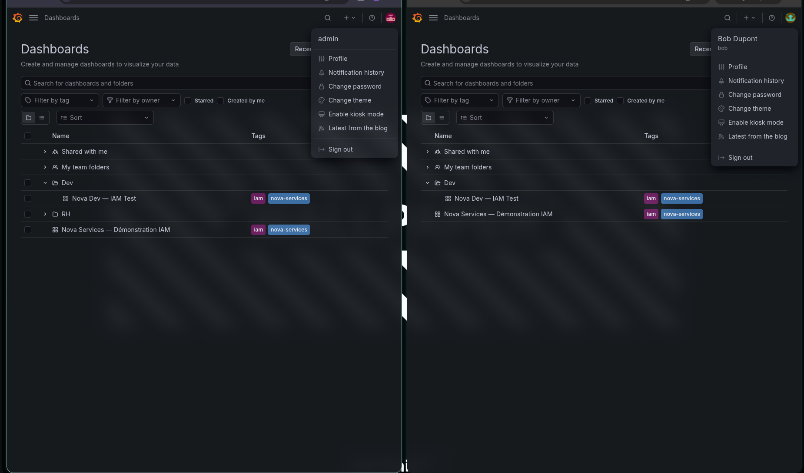
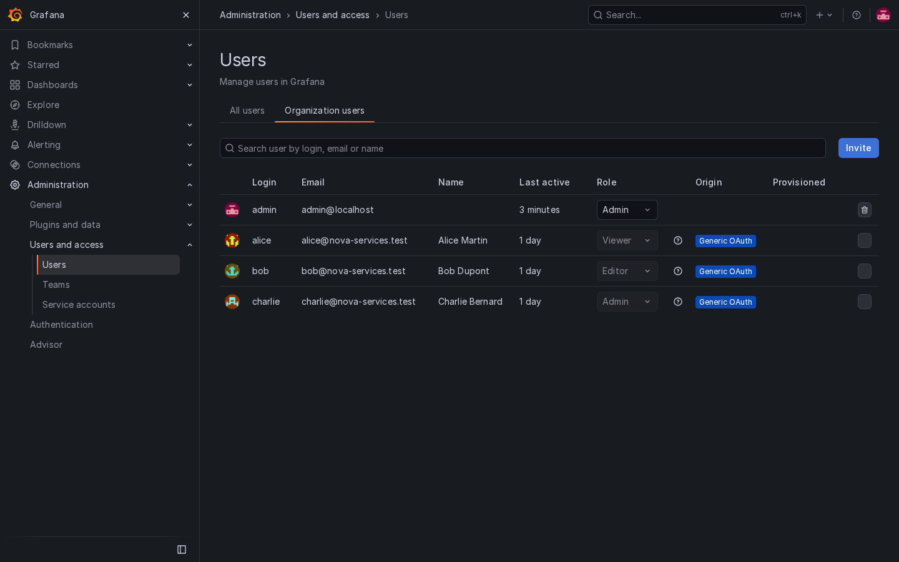

# TP2 — Gestion des identités, RBAC, MFA et SSO

## 1. Contexte

Nova Services complète le laboratoire TP1 avec la gestion des identités Authentik, le MFA, le RBAC et le SSO OIDC vers Grafana.

Actualisation du 25 novembre 2026 : voir [la recette finale](RECETTE_FINALE.md). Alice est actuellement active sans groupe Authentik et sans dispositif TOTP/Static ; son profil Grafana reste Viewer. Bob reste inactif Authentik. Les observations historiques ci-dessous ne remplacent pas ces mesures.

## 2. Architecture

Authentik est l'Identity Provider. Grafana est le client OIDC. PostgreSQL reste interne au réseau Docker `iam-network`.

## 3. Identités

Alice (`alice`), Bob (`bob`) et Charlie (`charlie`) sont configurés dans Authentik. Les mots de passe ne sont pas documentés.

La capture suivante montre les trois comptes actifs avant le départ de Bob, avec des noms d'utilisateur encore longs. Elle ne prouve pas les usernames finaux en minuscules ni l'état après départ.

## 4. Attributs métier

Les attributs `department`, `role` et `clearance_level` ont été vérifiés pour les trois comptes. Ils décrivent le métier et ne donnent pas automatiquement de privilège.

Preuve historique limitée à Charlie : role = System Administrator, department = IT, clearance_level = 5 ; le nom d'utilisateur affiché est encore Charlie Bernard. La capture ne couvre pas les attributs d'Alice et Bob.

## 5. Cycle de vie

Le déprovisionnement final de Bob a été exécuté : son compte Authentik est inactif, ses groupes ont été retirés et il a été supprimé de l'équipe nova-dev. Son profil Grafana externe reste présent et actif ; l'endpoint de désactivation a renvoyé HTTP 500, sans cause démontrée.

## 6. RBAC

| Groupe | Membre observé | Rôle Grafana |
|---|---|---|
| Admin | Charlie | Admin d'organisation |
| Dev | Bob avant départ | Editor |
| RH | Alice | Viewer |
| Audit | aucun | Viewer si affecté |

Cette matrice décrit l'affectation métier prévue, pas les appartenances finales. La première vue montre Admin, Audit, Dev et Rh juste après création, avec zéro membre. La seconde montre un membre dans Admin, DEV et RH et aucun dans Audit ; elle ne donne pas les noms des membres. La casse varie entre ces étapes historiques et la configuration finale.

## 7. MFA

Les exécutions historiques ont signalé une étape MFA et une connexion réussie. Le scénario ne vérifiait pas systématiquement l'identité connectée ; ces journaux ne suffisent donc pas à prouver le MFA des trois comptes. Au contrôle actuel, Charlie possède TOTP et Static, Bob TOTP, Alice aucun des deux. Les tests de code incorrect et de compte sans facteur restent NOT TESTED.

La capture fournie comme enrôlement d'akadmin montre un TOTP Device enregistré. L'attribution à akadmin vient du contexte fourni ; le nom n'est pas affiché en clair. Le champ dernière utilisation est vide : ce document ne prouve ni une connexion TOTP réussie ni le caractère obligatoire du facteur.

## 8. Recovery

La récupération repose sur des Static Tokens contrôlés, la vérification d'identité, la révocation de l'ancien périphérique, la révocation des sessions et le réenrôlement TOTP. Aucun code réel n'est conservé.

## 9. SSO / OIDC

Le flux est : navigateur → Grafana → Authentik → login/MFA → authorization code → token endpoint → userinfo → `nova_groups` → rôle Grafana. Les URLs front-channel et back-channel sont documentées dans `docs/oidc.md`.

## 10. Grafana

Le dashboard principal, les dashboards Dev/RH et les équipes `nova-dev`/`nova-rh` sont configurés. Les rôles API observés sont Alice Viewer, Bob Editor et Charlie Admin ; Bob est désormais absent de `nova-dev`.

## 11. Mapping des rôles

`Admin → Admin`, `Dev → Editor`, `RH → Viewer`, `Audit → Viewer`.

## 12. Dossiers Dev et RH

L'API confirme nova-dev → Edit sur Dev, nova-rh → View sur RH et Charlie → Admin sur les deux dossiers. Les captures historiques montrent un dashboard Dev et un refus RH. Elles n'affichent pas l'identité du compte ; les contrôles d'accès par utilisateur restent PARTIAL. Le journal historique signalait Alice → Dev comme FAIL, avec une attente de rendu insuffisante.

La comparaison historique ci-dessous apporte une identification visible : admin à gauche, Bob Dupont / bob à droite. Dev est listé pour Bob ; RH n'apparaît que chez admin. Cela prouve une différence de visibilité dans la liste, mais pas un refus sur URL directe ni une sauvegarde dans Dev.

## 13. Tests

La matrice complète et les statuts réels sont dans `docs/tests.md`. Les captures disponibles sont listées dans `captures/tp2/README.md`.

## 14. Mobilité Bob

Le scénario Dev → Audit → Viewer n'a pas été rejoué pour le rendu. La capture retrouvée montre explicitement le profil bob avec Viewer dans Main Org., synchronisé via Generic OAuth, ainsi que Grafana Admin = No. Elle documente un rôle historique différent du rôle Editor mesuré ultérieurement. L'image ne montre pas le groupe Audit dans Authentik, le retrait de Dev, une tentative d'édition refusée ou la restauration Editor : le scénario complet reste PARTIAL.

Après son départ, Bob n'appartient plus à Dev. Ces images historiques ne remplacent pas l'état mesuré dans la recette finale.

## 15. Départ de Bob

Le contrôle actuel confirme Bob inactif Authentik, sans groupe et absent de nova-dev. Des requêtes de révocation de session ont été acceptées lors du départ ; l'effet sur une session existante n'a pas été observé. Grafana conserve son profil Editor ; la requête de désactivation a échoué. Nouvelle connexion et ancienne session après départ restent NOT TESTED.

## 16. Sécurité

Les secrets restent dans `.env`, ignoré par Git. Aucun secret OIDC, mot de passe, QR code MFA, recovery code, token ou cookie n'est dans les captures ou la documentation.

Les 12 images de conversation ont été inspectées le 26 novembre 2026. Sept ont été sélectionnées sans modification des pixels ; les cinq autres restent locales. Les noms et adresses nova-services.test sont les identités fictives du TP. La fiche de Bob montre un champ mot de passe masqué et des sessions sur une adresse privée Docker, sans valeur de mot de passe ni identifiant de session. Les vues comportant une conversation adjacente ont été écartées.

## 17. Conclusion

L'infrastructure et la configuration OIDC sont fonctionnelles. La recette reste PARTIAL pour l'isolation des dossiers, les tests MFA négatifs, les codes de récupération et les sessions après départ. Les rôles Grafana et l'état Authentik sont vérifiés en lecture seule ; aucune reconstitution de scénario historique n'a été réalisée.
