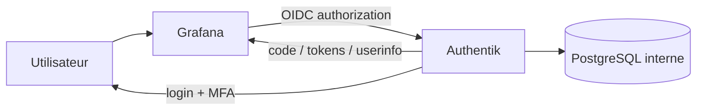
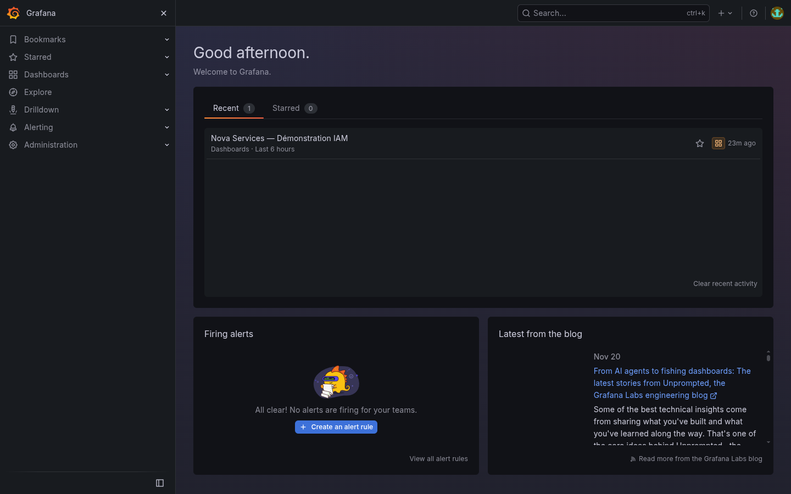
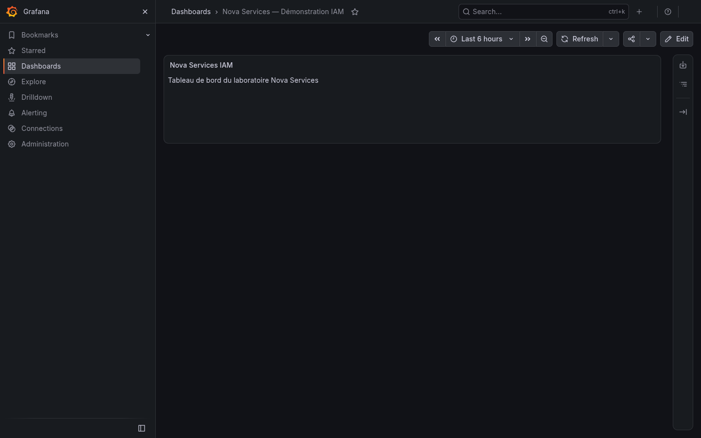
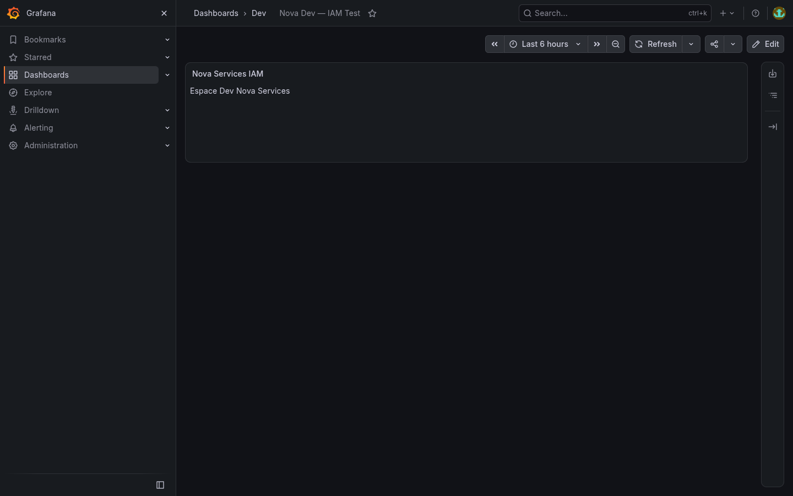
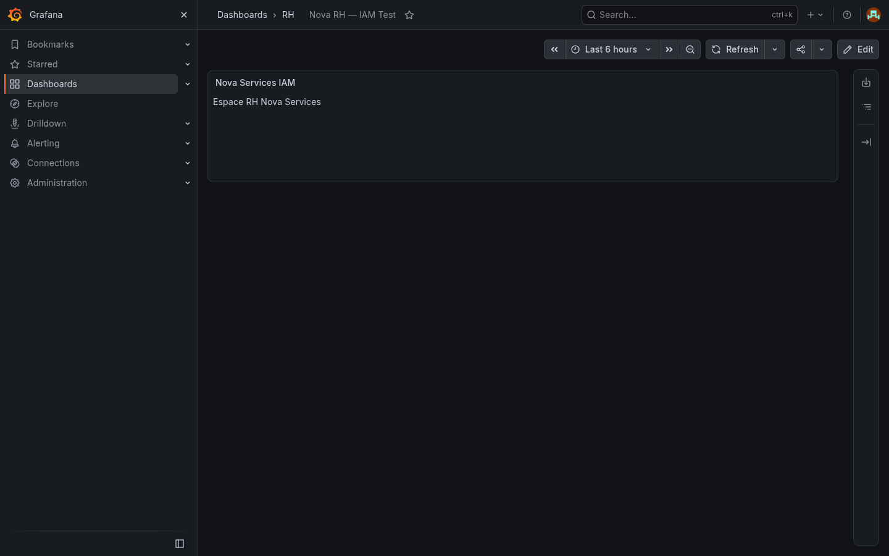
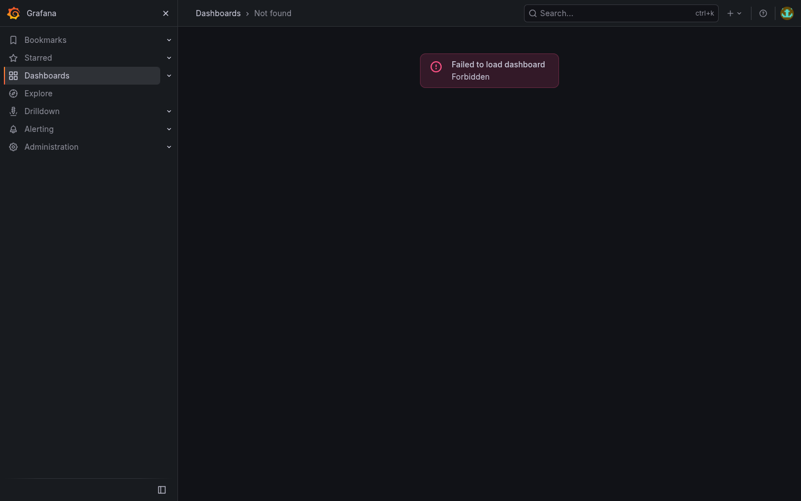

# TP2 — Gestion des identités, RBAC, MFA et SSO

## 1. Contexte

Nova Services complète le laboratoire TP1 avec la gestion des identités Authentik, le MFA, le RBAC et le SSO OIDC vers Grafana.

## 2. Architecture

Authentik est l'Identity Provider. Grafana est le client OIDC. PostgreSQL reste interne au réseau Docker `iam-network`.

## 3. Identités

Alice (`alice`), Bob (`bob`) et Charlie (`charlie`) sont configurés dans Authentik. Les mots de passe ne sont pas documentés.

## 4. Attributs métier

Les attributs `department`, `role` et `clearance_level` ont été vérifiés pour les trois comptes. Ils décrivent le métier et ne donnent pas automatiquement de privilège.

## 5. Cycle de vie

Le cycle de vie de Bob est préparé par scripts, mais le déprovisionnement n'a pas été exécuté pendant la recette finale. Bob est donc encore actif et membre de `Dev`.

## 6. RBAC

| Groupe | Membre observé | Rôle Grafana |
|---|---|---|
| Admin | Charlie | Admin d'organisation |
| Dev | Bob | Editor |
| RH | Alice | Viewer |
| Audit | aucun | Viewer si affecté |

## 7. MFA

Les connexions navigateur de Charlie, Alice et Bob ont demandé une intervention MFA manuelle et ont abouti. Les scénarios de mauvais code et de compte sans facteur n'ont pas été exécutés.

## 8. Recovery

La récupération repose sur des Static Tokens contrôlés, la vérification d'identité, la révocation de l'ancien périphérique, la révocation des sessions et le réenrôlement TOTP. Aucun code réel n'est conservé.

## 9. SSO / OIDC

Le flux est : navigateur → Grafana → Authentik → login/MFA → authorization code → token endpoint → userinfo → `nova_groups` → rôle Grafana. Les URLs front-channel et back-channel sont documentées dans `docs/oidc.md`.

## 10. Grafana

Le dashboard principal, les dashboards Dev/RH et les équipes `nova-dev`/`nova-rh` sont configurés. Les rôles API observés sont Alice Viewer, Bob Editor et Charlie Admin.

## 11. Mapping des rôles

`Admin → Admin`, `Dev → Editor`, `RH → Viewer`, `Audit → Viewer`.

## 12. Dossiers Dev et RH

`nova-dev` possède Edit sur Dev et `nova-rh` possède View sur RH. Bob a ouvert Dev et l'action Edit était visible. Bob a été refusé sur RH. Alice a ouvert RH, mais le dashboard Dev est resté accessible : ce résultat est conservé comme échec, sans correction silencieuse.

## 13. Tests

La matrice complète et les statuts réels sont dans `docs/tests.md`. Les captures disponibles sont listées dans `captures/tp2/README.md`.

## 14. Mobilité Bob

Le scénario Dev → Audit → Viewer n'a pas été relancé dans cette recette, car le jeton API Authentik n'était pas présent dans l'environnement. Bob est resté dans Dev.

## 15. Départ de Bob

Le déprovisionnement n'a pas été exécuté. Bob reste actif dans Authentik, membre de Dev, actif dans Grafana et membre de `nova-dev`. Les tests de nouvelle connexion et d'ancienne session après départ sont donc `NOT TESTED`.

## 16. Sécurité

Les secrets restent dans `.env`, ignoré par Git. Aucun secret OIDC, mot de passe, QR code MFA, recovery code, token ou cookie n'est dans les captures ou la documentation.

## 17. Conclusion

L'infrastructure et la chaîne OIDC sont fonctionnelles. La recette navigateur fournit des preuves partielles ; deux écarts restent visibles : le contrôle de la liste des utilisateurs Grafana doit être repris sur la route organisationnelle et Alice conserve un accès au dashboard Dev. Les scénarios de mobilité et de déprovisionnement restent à exécuter séparément.
