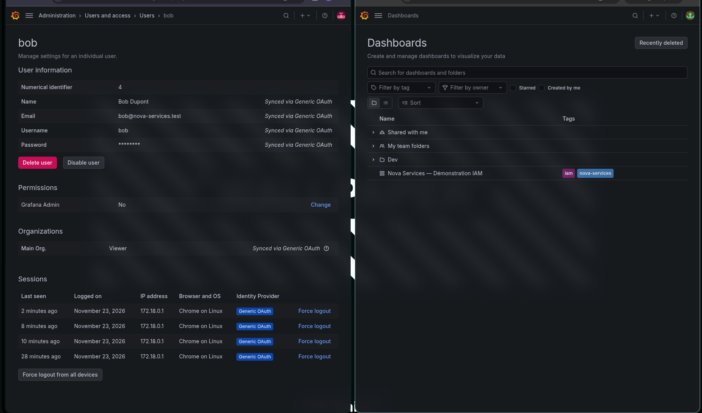

# Tests TP2

## Règle de statut

`PASS` est réservé à un résultat réellement observé. `PARTIAL` indique qu'une partie de la preuve est disponible mais qu'une action, une capture ou une vérification complémentaire manque. `NOT TESTED` indique qu'aucune exécution fiable n'a été réalisée.

## Matrice de validation réelle

| Test | Résultat attendu | Résultat observé | Preuve | Statut |
|---|---|---|---|---|
| Identités et attributs | Alice, Bob et Charlie conformes | Comptes actifs et attributs Charlie visibles historiquement ; autres attributs et usernames finaux non couverts par ces images | [Comptes historiques](../captures/tp2/conversation/01-users-authentik.png), [Charlie](../captures/tp2/conversation/02-attributs-charlie.png) | PARTIAL |
| Suspension/réactivation Bob | refus puis autorisation | Suspension exécutée ; réactivation non exécutée | aucune | PARTIAL |
| Groupes métier | Admin/Dev/RH/Audit et membres conformes | Création et effectifs intermédiaires visibles, noms des membres absents ; voir état final du 25/11 | [Création](../captures/tp2/conversation/03-groupes-crees.png), [Effectifs historiques](../captures/tp2/conversation/04-appartenances-historique.png) | PARTIAL |
| MFA obligatoire | facteur exigé | Un TOTP administratif est enregistré ; aucune preuve visuelle d'obligation ou de validation | [TOTP historique](../captures/tp2/conversation/05-mfa-akadmin-totp.png) | PARTIAL |
| Charlie TOTP valide | connexion acceptée | Réussite déclarée dans le journal historique ; nouvelle image 06 non attribuable à Charlie | Journal historique, aucune image concluante pour le scénario complet | PARTIAL |
| Charlie TOTP incorrect | connexion refusée | Non exécuté | aucune | NOT TESTED |
| Recovery code première utilisation | accepté | Non exécuté | aucune | NOT TESTED |
| Recovery code seconde utilisation | refusé | Non exécuté | aucune | NOT TESTED |
| Alice Viewer | rôle Viewer | API et vue des utilisateurs d'organisation : Viewer | 10a-grafana-roles.png | PASS rôle |
| Bob Editor | rôle Editor | API et vue des utilisateurs d'organisation : Editor, sans preuve de sauvegarde | 10a-grafana-roles.png | PASS rôle |
| Charlie Admin | Admin d'organisation | API et vue des utilisateurs d'organisation : Admin | 10a-grafana-roles.png | PASS rôle |
| Alice dashboard lecture seule | lecture sans modification | Modification non tentée | `11-dashboard.png` | NOT TESTED |
| Bob dashboard modification | sauvegarde autorisée puis restauration | Modification non tentée | `11-dashboard.png` | NOT TESTED |
| Bob dossier Dev | accès et édition | Dev et son dashboard sont listés avec bob identifié ; aucune sauvegarde visible | [Comparaison historique admin/Bob](../captures/tp2/conversation/14-dossier-dev-bob.png), [dashboard existant](../captures/tp2/14-folder-dev.png) | PARTIAL |
| Bob refus dossier RH | accès refusé sur URL directe | RH absent de la liste bob ; ancienne capture Forbidden retirée de la sélection publiée | [Comparaison historique](../captures/tp2/conversation/14-dossier-dev-bob.png) ; preuve URL directe manquante | PARTIAL |
| Alice refus dossier Dev | accès refusé | Dashboard Dev encore accessible | aucune | FAIL |
| Alice lecture dossier RH | lecture autorisée | L'image actuelle affiche Forbidden ; identité de session non contrôlée | `15-folder-rh.png` | PARTIAL |
| Bob Dev → Audit → Viewer | groupe Audit, rôle Viewer, édition refusée puis restauration | Fiche bob Viewer synchronisée OAuth visible historiquement ; Audit et refus d'édition absents | [Bob Viewer historique](../captures/tp2/conversation/13-bob-viewer-apres-mobilite.png) | PARTIAL |
| Alice sans groupe autorisé | accès refusé | Non exécuté | aucune | NOT TESTED |
| Déprovisioning Bob | compte et accès retirés | Authentik inactif, groupes retirés, session Grafana révoquée, équipe retirée ; profil Grafana externe non désactivé | aucune | PARTIAL |
| Nouvelle connexion Bob après départ | refusée | Fenêtre fermée avant observation du refus | `17-bob-disabled.png` absent | NOT TESTED |
| Ancienne session Bob après départ | comportement documenté | Session conservée avant révocation, résultat du refresh non récupéré | aucune | NOT TESTED |

## Réserves et contrôle du 25 novembre 2026

La matrice ci-dessus retrace la recette précédente ; les observations suivantes précisent sa portée :

- Alice est active, sans groupe Authentik et sans périphérique TOTP/Static ; son profil Grafana est Viewer dans nova-rh. L'ancienne mention Alice RH est un état initial, pas l'état final mesuré.
- Bob est inactif Authentik, sans groupe et absent de nova-dev. Son profil Grafana reste Editor, non désactivé. Charlie reste actif, groupe Admin, rôle Admin d'organisation.
- Charlie possède un TOTP et un dispositif Static ; Bob possède un TOTP. Leur présence ne prouve ni le refus d'un code incorrect ni l'usage unique des codes de récupération.
- La capture 15-folder-rh.png montre Forbidden. La lecture RH par Alice est donc PARTIAL : l'image actuelle ne la prouve pas et le scénario ne vérifiait pas l'identité connectée.
- Les images 11 et 14 montrent les dashboards et un bouton Edit, pas une sauvegarde réussie ni l'identité connectée. Le test Bob Editor reste PARTIAL.
- Le refus RH de 16a est visible, mais son attribution à Bob repose sur le déroulé historique, pas sur une identité visible dans l'image.
- Les attentes Playwright historiques pouvaient accepter un menu ou un ancien rendu ; les échecs Alice Dev et Charlie Users doivent être rejoués avec contrôle de l'identité et de la réponse API avant d'en déduire une cause.
- L'erreur HTTP 500 de désactivation Grafana est observée ; aucune incompatibilité générale des comptes OAuth n'est démontrée.

Le rendu n'a relancé aucune mutation ou connexion Bob. Voir [RECETTE_FINALE.md](RECETTE_FINALE.md) pour la synthèse des mesures actuelles.

## Captures navigateur réalisées

- `09-grafana-sso.png` : Grafana après authentification OIDC réussie.
- 10-grafana-users.png et 10a-grafana-roles.png : profils OAuth et rôles actuels, consultés avec admin local le 25 novembre.
- `11-dashboard.png` : dashboard principal Nova Services.
- `14-folder-dev.png` : dashboard Dev accessible à Bob avec l'action Edit visible.
- `15-folder-rh.png` : diagnostic Forbidden ; ne prouve pas un accès RH autorisé.
- `16a-bob-rh-denied.png` : refus d'accès de Bob au dashboard RH.

Les captures ont été inspectées et ne contiennent ni secret, ni QR code, ni token, ni cookie visible.

## Validation technique OIDC

Les vérifications techniques suivantes sont exécutées avant le commit final :

```bash
docker compose config --quiet
docker compose ps
bash scripts/verify.sh
bash scripts/verify_oidc.sh
curl -fsS http://localhost:3000/api/health
curl -fsS http://localhost:9000/application/o/grafana/.well-known/openid-configuration | python3 -m json.tool
```

Ces contrôles ne remplacent pas les tests humains MFA/RBAC.

## Intégration des preuves de conversation — 26 novembre 2026

Les 12 images fournies ont été comparées aux cinq PNG TP2 déjà présents. Sept preuves complémentaires sont intégrées ; cinq images restent locales, selon l'[inventaire de sélection](../captures/tp2/conversation/README.md). Aucun fichier existant n'est remplacé et aucun état intermédiaire ne devient implicitement l'état final.



Le rôle Viewer affiché est un constat limité à cet instant. Le scénario mobilité reste PARTIAL : groupe Audit, retrait de Dev, refus d'enregistrement, reconnexion et restauration Editor ne sont pas montrés ensemble. La comparaison de dossiers identifie admin et bob, mais ne teste pas une URL interdite.

Les anciennes mentions de 15-folder-rh.png et 16a-bob-rh-denied.png dans le journal ci-dessus concernent des diagnostics archivés localement, pas des images disponibles dans la sélection GitHub actuelle.

Preuves toujours manquantes : attributs Alice/Bob en image, membres nominatifs de chaque groupe, succès/refus MFA complet, récupération et réutilisation, sauvegarde Editor, refus Viewer, refus Alice Dev et Bob RH sur URL directe, Alice sans groupe, départ et sessions Bob après départ, paire de persistance TP1.

### Vérifications de l'intégration

| Vérification du 26 novembre 2026 | Résultat |
|---|---|
| Compose, quatre services healthy, verify.sh, verify_oidc.sh, API de santé Grafana | PASS |
| Références Markdown locales, respect de la casse et intégrité CRC des PNG | PASS |
| HTML généré par le moteur Markdown GitHub, puis chargement des 18 références d'images dans Chromium avec les fichiers locaux | PASS |
| Secrets et données personnelles des 12 images | Inspection visuelle ; seules les sept images retenues entrent dans le commit |
| Découverte de la suite Playwright avec --list | PASS ; aucun scénario de mutation relancé |
| Chargement distant des nouvelles images sur github.com | À vérifier après un push autorisé ; aucune publication effectuée pour cette intégration |

Le test du rendu GitHub vérifie la syntaxe et le décodage des fichiers préparés. Il ne prétend pas que les nouvelles images, encore locales, sont déjà hébergées sur GitHub.
